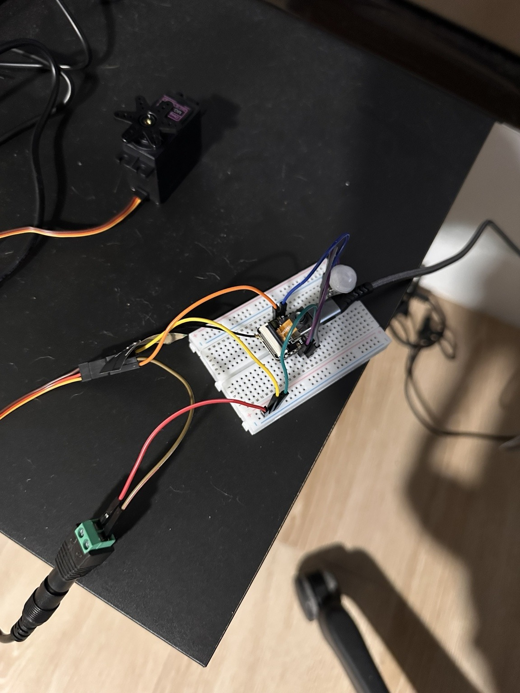
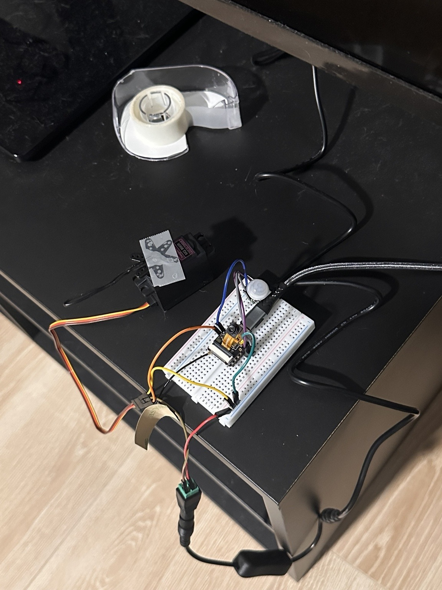
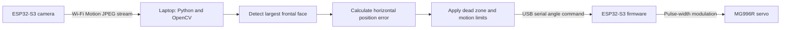

# Vision-Tracked Interactive Turret

**Computer vision + embedded control | Working proof of concept | July 2026**

A camera-driven, single-axis face-following prototype built to explore a proposed **Star Wars-inspired interactive room installation**. A family member who designs themed rental spaces wanted a decorative prop that could respond to a guest entering the room and turn toward them as they moved. I built a smaller working prototype to validate the key **camera-to-motion tracking behavior** before attempting a full-scale installation.

**Demonstrated outcome:** A camera stream was processed on a laptop to detect a frontal face, estimate its horizontal position, and send motion commands back to an ESP32-S3 microcontroller. An externally powered servo physically followed the detected face during testing.

> **Prototype scope:** The final installation, synchronized room lights, and automatic room-entry activation were *concept goals*, not completed parts of this integrated demonstration. A passive infrared motion sensor was tested separately, but was not wired into the recovered face-following program. This is a decorative, non-projectile prop.

## Hardware prototype

| Prototype wiring | Breadboard and servo setup |
|---|---|
|  |  |

**Demo video:** A 55-second original test recording exists, but it has been withheld from this public-ready package pending a final review for recognizable people and household details. These photographs are authentic hardware images, not generated mockups.

## Why I built it

The proposed guest experience required two engineering capabilities: **sensing a person's position** and **driving physical motion in response**. Rather than build a complete enclosed prop immediately, I separated the problem into a camera microcontroller, a computer-vision processing application, and a servo-control feedback path. This demonstrated the core behavior on an inexpensive development-board setup while exposing mechanical-alignment and control challenges early.

## System architecture



**Division of work:** The camera captures and streams frames, while the laptop performs detection and position calculations. The microcontroller receives serial angles and controls the servo. **Face detection does not run on the ESP32-S3.**

### Hardware

- **Seeed Studio XIAO ESP32S3 Sense:** Camera input, wireless video stream, angle-command reception, and servo control.
- **MG996R servo motor:** Single-axis physical movement, with signal connected to `D2`.
- **Separate motor supply and shared ground:** Prevented powering the motor directly from the controller input/output pin.
- **Laptop and Universal Serial Bus (USB) cable:** Ran computer vision and carried serial angle commands to the board.
- **Passive infrared (PIR) sensor:** Used in a separate motion-response experiment; not connected to the recovered tracking loop.

### Software

- **Embedded:** Arduino-style C++ using the ESP32 camera and servo libraries.
- **Host:** Python, the Open Source Computer Vision Library (OpenCV), and PySerial.
- **Camera feed:** Motion JPEG (MJPEG) stream exposed at `http://DEVICE_IP:81/stream`.
- **Detection:** OpenCV's pretrained frontal-face Haar cascade. It detects faces; it does **not** identify people.

## How the working loop operated

1. The ESP32-S3 exposed a camera stream over a local Wi-Fi connection.
2. The host program decoded frames at **320 × 240 pixels** and detected frontal faces.
3. When more than one face was found, it selected the **largest detected bounding box**, not a persistent person's identity.
4. It measured the face's horizontal offset from the image center and ignored offsets of **35 pixels or less**, reducing unnecessary servo adjustments near the center.
5. It applied incremental corrections using a gain of **0.040 degrees per pixel** and constrained requested angles to **60°–130°** on the host.
6. It sent newline-terminated angle commands over USB serial at **115,200 baud**, with a **30-millisecond minimum interval** between sends. This interval is not a measured tracking rate.
7. The board drove the servo at **50 hertz**, with a wider firmware clamp of **20°–160°**. When no face was found, the servo held its previous position.

Host shortcuts: `q` quit, `c` return to 90°, `i` invert tracking direction. The display included a face box, centerline, servo angle, and `FACE LOCK`/`NO FACE` indicators.

## Engineering decisions and outcomes

| Engineering challenge | Approach | Verified or intended effect |
|---|---|---|
| Run vision tracking without overloading the microcontroller | Processed detection on a laptop and streamed camera frames from the ESP32-S3 | Enabled a working camera-to-servo demonstration on the available hardware |
| Prevent continual small corrections when the face was near the center | Added a 35-pixel dead zone | Avoided commanding minor center-position adjustments |
| Bound physical servo movement | Applied both host-side and firmware angle limits | Restricted requested positions within defined ranges |
| Debug reversed physical alignment without reflashing | Added an interactive direction-inversion key | Allowed the correction direction to be changed while the tracking script ran |
| Coordinate camera and motor operation | Used separate timer resources for camera and servo control | Allowed camera streaming and serial-controlled servo operation to coexist in the prototype |

## Repository layout

```text
firmware/VisionTrackedTurret/
  VisionTrackedTurret.ino   # Example-derived camera setup + project-specific Wi-Fi/servo integration
  camera_pins.h            # Seeed CameraWebServer pin definitions (third-party)
  app_httpd.cpp            # Seeed CameraWebServer copy, Espressif-derived (third-party)
  camera_index.h           # Seeed CameraWebServer web UI copy (third-party)
tracking/
  face_tracking.py         # Laptop-side vision and angle-control program
  requirements.txt         # Host-side Python dependencies
docs/
  SETUP.md                 # Reproduction guidance and prerequisites
  TESTING.md               # Evidence, limitations, and future work
  SOURCE_ATTRIBUTION.md    # Origin and modification notes
media/                       # Original hardware photographs
```

## Set up and run

See [docs/SETUP.md](docs/SETUP.md). The published source uses placeholders for the wireless credentials and camera address, so the project **does not run without local setup and real hardware**. The recovered firmware has **not been freshly compiled on current toolchains**, and this bundle is not claimed to be a turnkey reproduction.

## What I tested and what remains

The completed camera → laptop detection → serial command → **physical servo movement** loop worked on a breadboard prototype. I also separately tested motion-triggered servo behavior using the PIR sensor. No validated tracking latency, frame rate, range, accuracy, or commercial performance figures are available. The final themed-room installation and lighting integration remain unbuilt aspects of the original concept.

For testing evidence, caveats, and possible next steps, see [docs/TESTING.md](docs/TESTING.md).

## Credits and reuse

This is an **engineering integration project**, not a from-scratch camera-server or face-detection implementation.

**Camera-server source:** [limengdu / SeeedStudio-XIAO-ESP32S3-Sense-camera, `CameraWebServer_for_esp-arduino_3.0.x`](https://github.com/limengdu/SeeedStudio-XIAO-ESP32S3-Sense-camera/tree/main/CameraWebServer_for_esp-arduino_3.0.x), itself adapted from [Espressif's Arduino CameraWebServer example](https://github.com/espressif/arduino-esp32/tree/master/libraries/ESP32/examples/Camera/CameraWebServer). The local `app_httpd.cpp` and `camera_index.h` files **exactly match** the Seeed version, and `camera_pins.h` matches except for a leading blank line. Camera initialization in `VisionTrackedTurret.ino` is based on that example. The note about a February 2026 modification in `camera_index.h` is also in the upstream version and is **not claimed as this project's work**.

**Project-specific work:** Integrated the existing wireless camera stream with laptop-side Python/OpenCV face detection, face-position error calculations, movement limiting, serial communication, and physical servo control. OpenCV's pre-trained Haar cascade, ESP32Servo, and the board libraries are third-party dependencies.

See [docs/SOURCE_ATTRIBUTION.md](docs/SOURCE_ATTRIBUTION.md) for a file-by-file breakdown. License texts for the applicable upstream sources are in [`third_party_licenses/`](third_party_licenses/). Those third-party licenses are **not** a project-wide license; no license is yet selected for the original portions of this repository.
